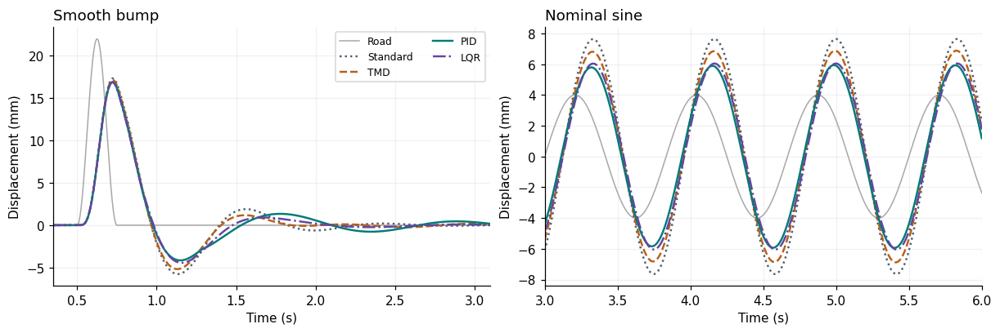
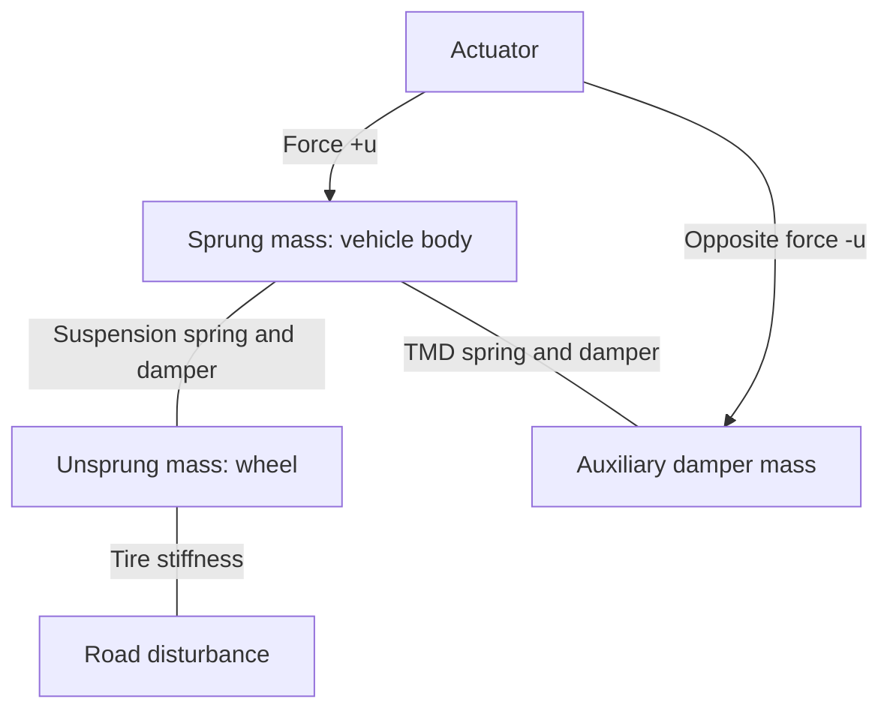
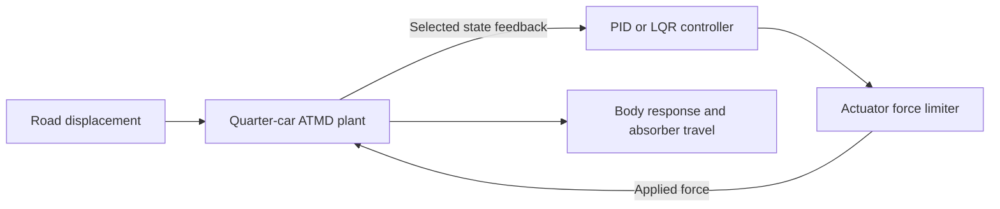

# Active Tuned Mass Damper Control for a Quarter-Car Model

**Automotive vibration control · PID vs. LQR · Python simulation**

This independent engineering project investigates how an active tuned mass damper (ATMD) can reduce vertical vehicle-body displacement while limiting actuator effort. Inspired by motorsport applications, it compares a standard quarter-car suspension, a passive tuned mass damper (TMD), ATMD-PID, and ATMD-LQR under identical road disturbances. The analysis includes frequency response, mechanical travel limits, and parameter sensitivity.

**11.41%** lower peak displacement with PID · **10.53%** with LQR · **~14%** lower RMS actuator force with LQR than PID.

The displacement reductions use the passive TMD as the baseline for a 4 mm, 1.2 Hz sinusoidal road input.

[Simulation notebook](ATMD_Quarter_Car_Colab.ipynb) | [Research paper (PDF)](Research/Paper_ATMD_PID_LQR_English_Final.pdf) | [Portfolio poster (PDF)](ATMD_Portfolio_Poster.pdf)

> **Scope:** Simulation-based engineering study. The ATMD design has not been validated on a physical vehicle.

## Results at a Glance

### Nominal road input: 4 mm amplitude at 1.2 Hz

| Configuration | Peak body displacement (mm) ↓ | Reduction vs. passive TMD | RMS actuator force (N) ↓ |
|---|---:|---:|---:|
| Standard vehicle | 7.64 | — | — |
| Passive TMD | 6.88 | Baseline | — |
| ATMD-PID | **6.10** | **11.41%** | 3.51 |
| ATMD-LQR | 6.16 | 10.53% | **3.02** |

*Original simulation plots from the notebook. The nominal peak includes the startup transient; RMS force is evaluated over the last three sinusoidal periods.*

- **Engineering trade-off:** PID produced the smallest nominal peak. LQR achieved a comparable reduction with less RMS force and smaller peak absorber travel (27.86 mm vs. 36.64 mm for PID).
- **Travel-limit case:** At 30 mm road amplitude and 1.2 Hz, end-stop contact altered the response. PID produced a peak 1.60% higher than the passive TMD; LQR retained a 0.70% reduction.
- **Frequency response:** Within the studied range of 0.55–2.50 Hz, continuous linear road-to-body gain was lower than the passive TMD over approximately 0.885–1.700 Hz for PID and 0.763–1.938 Hz for LQR.

RMS actuator force is not a direct measure of electrical energy consumption. Controller ranking depends on the road input, model parameters, controller settings, and physical limits.

## System Architecture

### Quarter-car ATMD plant

The model uses vertical displacement relative to static equilibrium. The actuator applies equal and opposite forces to the body and auxiliary mass. The plant includes mechanical end-stop contact.

### Closed-loop active control

The active configurations use one controller at a time.

| Strategy | Control and feedback |
|---|---|
| Standard vehicle | Suspension and tire; no auxiliary mass |
| Passive TMD | Auxiliary mass, spring, and damper; no active force |
| ATMD-PID | Body displacement and velocity feedback with leaky integral action and anti-windup |
| ATMD-LQR | State feedback of positions and velocities of all three masses |

## Engineering Approach

1. **Mathematical modeling:** derive Newton equations and implement the state-space model.
2. **Controller design:** tune a passive TMD and compare PID/LQR candidates on separate training scenarios; freeze the selected gains before evaluation.
3. **Response analysis:** compare smooth bump, sinusoidal, and processed measured-road inputs using peak/RMS displacement, actuator force, relative travel, settling, and Bode plots.
4. **Sensitivity analysis:** the recorded notebook run evaluated seven factors, 9,216 parameter sets, and three damper configurations (27,648 simulations). Total-order Sobol indices identify road amplitude as the dominant factor for peak body displacement and excitation frequency for additional peak reduction in the selected ranges.
5. **Physical constraints:** model a 255 N peak actuator force limit, screen against continuous force and speed ratings, and model end-stop contact at ±40 mm. Estimate motoring input power with an assumed 95% efficiency, without regeneration credit.

## Numerical Verification

An independent numerical recheck reran all 36 evaluation trajectories across nine scenarios and four configurations. All 360 displayed table fields agreed at the notebook's reported precision. Re-evaluation of 276 controller candidates across two training scenarios reproduced the selected PID and LQR gains. The nominal frequency-response benefit intervals were also reproduced.

[Read the numerical recheck and reproduce it](verification/README.md). This is a separate JavaScript numerical audit of the saved Python model, not a new execution of the entire Python notebook. The 27,648-run Monte Carlo batch and published reference-case checks are from the recorded notebook run.

## Reproduce the Study

**Tools:** Python · NumPy · SciPy · pandas · Matplotlib · Google Colab

1. Open the [Colab notebook](https://colab.research.google.com/github/IhsanSA/atmd-quarter-car-control/blob/main/ATMD_Quarter_Car_Colab.ipynb).
2. Select **Runtime → Run all**.
3. Review the model parameters, controller gains, road scenarios, and results.
4. Change inputs and rerun relevant cells to explore other scenarios.

The notebook includes an embedded measured-road segment. The complete CSV is needed to select other road sections. The [editable portfolio poster](ATMD_Portfolio_Poster.pptx) is also available.

## Demonstrated Engineering Skills

- Dynamic-system modeling and state-space analysis
- PID and optimal state-feedback control design
- Time- and frequency-domain analysis
- Parameter sensitivity and reproducible numerical simulation
- Actuator constraints, engineering trade-offs, and technical communication

## Limitations and Next Steps

- Validate the modeled vehicle and damper responses with physical measurements; provide static-load support or preload for the auxiliary mass.
- Refine actuator assumptions using measured force–velocity, efficiency, and thermal characteristics.
- Develop a sensor and state estimator for practical LQR implementation.
- Extend the quarter-car model to pitch and roll, evaluate additional road data, and perform hardware-in-the-loop testing.

Reference-model verification does not constitute physical validation of this ATMD design.

## License

See [LICENSE](LICENSE).
